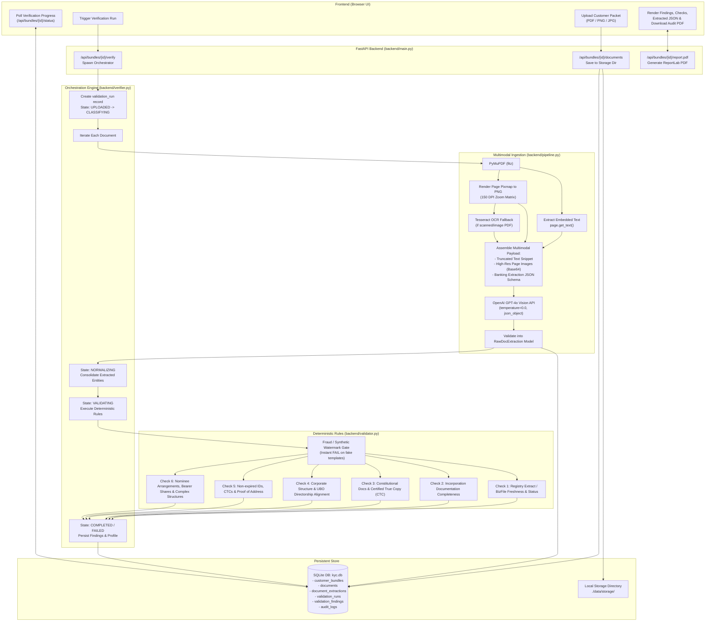

# Wholesale Banking KYC & Policy Validation Engine — Implementation Guide

## Executive Overview
The **Wholesale Banking KYC & Policy Validation Engine** is an automated compliance verification platform designed for corporate banking onboarding and periodic KYC reviews. It handles corporate document packets (ACRA BizFile, Certificate of Incorporation, Memorandum & Articles of Association, Register of Members/Directors, UBO Declarations, Passports, Proof of Address) and validates them against regulatory requirements and bank policies (CTC compliance, expiration, UBO cross-checks, corporate structure validation, and synthetic/fraudulent document detection).

---

## 1. Codebase Architecture & Data Flow

### 1.1 Architecture Components

```
wholesale-banking-client-validator/
├── backend/
│   ├── __init__.py    # Package initializer marking backend as a Python module
│   ├── auth.py        # Cookie-based in-memory session authentication and credential verification
│   ├── config.py      # App configuration, environment variable loading, and file storage paths
│   ├── db.py          # SQLite database connection lifecycle, schema migrations, and audit logging
│   ├── main.py        # FastAPI web server, REST API routing, authentication middleware, and static UI serving
│   ├── models.py      # Pydantic data schemas, enums, extraction models, findings, and check results
│   ├── pipeline.py    # Document text extraction (PyMuPDF / Tesseract) and multimodal GPT-4o vision extraction
│   ├── reports.py     # Branded PDF audit report generation using ReportLab flowables and tables
│   ├── rules.py       # Wholesale policy rule definitions, check codes, metadata, and failure conditions
│   ├── seed.py        # Automatic seeding of sample wholesale customer bundles and test documents on startup
│   ├── validator.py   # Deterministic rules engine executing all banking policy checks across extracted bundle data
│   └── verifier.py    # Verification orchestrator driving the end-to-end multi-state processing pipeline
├── frontend/          # Single-Page Application (HTML5, Vanilla CSS, Modern JavaScript)
│   ├── index.html     # Dashboard layout, tabs, bundle details, document inspection modal
│   ├── styles.css     # Design tokens, typography, dark/light compliance themes
│   └── app.js         # API integration, state management, reactive status polling
└── kyc-test-docs/     # Synthetic corporate test bundles & edge cases
```

### 1.2 Backend Python Scripts Summary

| Script | 1-Line Description |
| :--- | :--- |
| [`backend/__init__.py`](file:///c:/Works/GLDB_Singapore/wholesale-banking-client-validator/backend/__init__.py) | Package initializer defining the `backend` directory as an importable Python package. |
| [`backend/auth.py`](file:///c:/Works/GLDB_Singapore/wholesale-banking-client-validator/backend/auth.py) | Handles constant-time credential checking and generates HTTP-only session cookie tokens. |
| [`backend/config.py`](file:///c:/Works/GLDB_Singapore/wholesale-banking-client-validator/backend/config.py) | Manages application settings, `.env` file loading, DPI/page limits, and storage directory resolution via Pydantic Settings. |
| [`backend/db.py`](file:///c:/Works/GLDB_Singapore/wholesale-banking-client-validator/backend/db.py) | Initializes SQLite tables, manages thread-safe database connections, logs audit events, and provides UUID generation helpers. |
| [`backend/main.py`](file:///c:/Works/GLDB_Singapore/wholesale-banking-client-validator/backend/main.py) | Exposes the FastAPI REST API, handles file uploads and report downloads, enforces authentication middleware, and serves frontend static assets. |
| [`backend/models.py`](file:///c:/Works/GLDB_Singapore/wholesale-banking-client-validator/backend/models.py) | Declares Pydantic data models and enums for extractions, processing states, verdicts, findings, and normalized company profiles. |
| [`backend/pipeline.py`](file:///c:/Works/GLDB_Singapore/wholesale-banking-client-validator/backend/pipeline.py) | Extracts digital text via PyMuPDF, falls back to Tesseract OCR, renders high-DPI page images, and calls GPT-4o Vision for structured JSON extraction. |
| [`backend/reports.py`](file:///c:/Works/GLDB_Singapore/wholesale-banking-client-validator/backend/reports.py) | Generates professional, branded PDF compliance audit reports containing client profiles, check verdicts, and findings tables using ReportLab. |
| [`backend/rules.py`](file:///c:/Works/GLDB_Singapore/wholesale-banking-client-validator/backend/rules.py) | Defines the catalog of 10 wholesale banking validation rules, failure conditions, severities, and target document mappings. |
| [`backend/seed.py`](file:///c:/Works/GLDB_Singapore/wholesale-banking-client-validator/backend/seed.py) | Seeds the SQLite database with initial demo wholesale banking client bundles and pre-loads test files on empty database startups. |
| [`backend/validator.py`](file:///c:/Works/GLDB_Singapore/wholesale-banking-client-validator/backend/validator.py) | Executes 100% deterministic compliance checks, cross-verifying UBO percentages, expiry dates, CTC stamps, and fraud flags against bank policies. |
| [`backend/verifier.py`](file:///c:/Works/GLDB_Singapore/wholesale-banking-client-validator/backend/verifier.py) | Orchestrates the end-to-end verification state machine across document extraction, entity normalization, rule evaluation, and database persistence. |

---

### 1.3 End-to-End Data Flowchart

The state transition flow moves through defined lifecycle states:
`UPLOADED` $\rightarrow$ `CLASSIFYING` $\rightarrow$ `EXTRACTING` $\rightarrow$ `OCR_PROCESSING` $\rightarrow$ `VISION_PROCESSING` $\rightarrow$ `NORMALIZING` $\rightarrow$ `VALIDATING` $\rightarrow$ `COMPLETED`



---

## 2. Deep Dive: PDF Data Extraction & The Role of GPT-4o

### 2.1 How Data Extraction is Performed from `.pdf` Files

Extracting corporate data from PDFs is not a single tool action. Wholesale banking documents come in two formats:
1. **Digital / Vector PDFs:** Generated directly by software (e.g., ACRA BizFile downloads) containing selectable font glyphs and text streams.
2. **Scanned / Photocopied PDFs:** Physical pages scanned by scanner apps or mobile cameras containing only bitmap images without native text layers.

The codebase implements a **hybrid dual-layer extraction pipeline** in [backend/pipeline.py](file:///c:/Works/GLDB_Singapore/wholesale-banking-client-validator/backend/pipeline.py) (`extract_text_and_images`):

```python
# 1. Open the PDF in memory with PyMuPDF
with pymupdf.open(file_path) as pdf:
    zoom = settings.RENDER_DPI / 72.0  # e.g., 150 DPI / 72 = 2.083x resolution scaling
    matrix = pymupdf.Matrix(zoom, zoom)
    for i, page in enumerate(pdf):
        if i >= settings.MAX_PAGES_PER_DOC: # limit to max 6 pages to manage token budget
            break
            
        # STEP A: Direct digital text extraction
        txt = page.get_text()
        if txt.strip():
            digital_text_parts.append(txt)

        # STEP B: Render high-resolution raster image (Pixmap)
        pix = page.get_pixmap(matrix=matrix, alpha=False)
        png_bytes = pix.tobytes("png")
        png_pages.append(png_bytes)

        # STEP C: OCR Fallback if the page is a pure scan
        if not txt.strip() and HAS_TESSERACT:
            ocr_t = pytesseract.image_to_string(Image.open(BytesIO(png_bytes)))
            if ocr_t.strip():
                digital_text_parts.append(ocr_t)
```

#### Why are pages converted to PNG images?
Standard PDF text scrapers strip out all spatial layout, stamp locations, physical wet-ink signatures, company seals, watermarks, and notarization stamps. By converting each PDF page into a high-DPI image, the pipeline retains the **exact visual appearance** of the page.

---

### 2.2 What is GPT-4o Doing Post-Extraction?

Once the text and image frames are prepared, they are combined into an OpenAI Multimodal Chat Completion request with `temperature: 0.0` and `response_format: {"type": "json_object"}`.

GPT-4o acts as a **Multimodal Document Understanding Agent**, performing six distinct cognitive tasks:

#### 1. Autonomous Document Classification
- It inspects the visual formatting, headings, and legal clauses to classify the document into one of 10 types (`bizfile`, `cert_incorporation`, `maa`, `rom`, `rod`, `board_resolution`, `ubo_declaration`, `id_document`, `proof_of_address`, or `other`).
- This eliminates the need for users to manually tag or categorize uploaded files.

#### 2. Visual Seal, Stamp & Certified True Copy (CTC) Detection
- Traditional OCR cannot recognize whether an ink stamp says *"Certified True Copy"*, whether a notary signature is present, or whether a signature line is completely blank.
- GPT-4o examines the visual pixels to detect:
  - `is_ctc` (True/False)
  - `ctc_signature_found` (True/False)
  - `ctc_date`
  - `is_fully_executed` (checks whether execution clauses, dates, and director signatures are actually present or left as blank lines).

#### 3. Fraud and Synthetic Template Detection
- Synthetic documents created using fraudulent templates often leave visual artifacts or watermarks that pure OCR ignores.
- GPT-4o visually scans for known template generator marks (e.g., `Yutempl.com`, `shotempl.com`, `faketemplate`) and dummy placeholder numbers (e.g., `S0000000H`, `00-00-0000`). If detected, it sets `is_fraudulent_or_template: true` with explicit `fraud_reasons`.

#### 4. Tabular & Nested Entity Normalization
- Register of Members (ROM) and Register of Directors (ROD) contain multi-column tables with varying layouts.
- GPT-4o parses these tables into structured JSON lists of `directors` and `ubos` (with individual ownership percentages, share counts, appointment dates, and nationality).

#### 5. Expiration & Temporal Reasoning
- For passports and identity cards, GPT-4o extracts `id_expiry_date` and compares it with the current date injected into the system prompt (`{today}`), setting `is_expired: true/false`.

#### 6. Separation of Concerns: LLM Extraction vs. Deterministic Rules
> **Critical Architectural Design:**
> GPT-4o **does not decide** whether the customer passes or fails bank compliance. It is strictly used as an **extraction and observation engine**. 
> The legal compliance verdicts (`PASS`, `FAIL`, `EXCEPTION_REQUIRED`) are computed 100% deterministically in [backend/validator.py](file:///c:/Works/GLDB_Singapore/wholesale-banking-client-validator/backend/validator.py) using audited mathematical logic, date math, and bank policy rules.

---

## 3. Further Optimization Plans & Implementation Strategy

### 3.1 Optimization Matrix

| Area | Current Implementation | Proposed Optimization | Expected Impact |
| :--- | :--- | :--- | :--- |
| **Performance** | Sequential synchronous extraction of documents in a `for` loop | **Async Parallel Extraction** using `asyncio.gather` with a bounded semaphore | **$3\times$ to $5\times$ faster** verification runtime per bundle |
| **Cost & Latency** | High-detail GPT-4o vision sent for all pages of all documents | **Tiered Model Routing** (mini vision model for classification, full vision only for complex docs) | **60–75% reduction** in OpenAI API token costs |
| **Caching** | Re-extracts documents on every single verification run | **Content-Addressed Extraction Caching** (SHA-256 hash of document binary) | **Instant reruns (0 cost)** when re-evaluating existing files |
| **Scalability** | Background tasks run directly inside the FastAPI web server thread | **Decoupled Task Queue** (Celery / ARQ / Redis) | Zero server blocking; supports horizontal scaling |
| **Data Extraction** | Pure prompt-based JSON output parsing | **OpenAI Structured Outputs** (`response_format` with Pydantic JSON schema) | Zero JSON decode errors; guaranteed schema conformity |

---

### 3.2 Concrete Implementation Steps

#### Plan A: Async Parallel Document Processing (`backend/verifier.py`)
Currently, `backend/verifier.py` executes document extraction sequentially:
```python
for doc in docs:
    ext = extract_document_with_vision(doc_path, doc["original_name"], today=today)
```
If a customer has 5 documents and each OpenAI call takes 6 seconds, the verification takes 30+ seconds.

**Implementation:**
Convert to asynchronous tasks with concurrency limiting (e.g. max 3 parallel requests):
```python
import asyncio

semaphore = asyncio.Semaphore(3)

async def _extract_worker(doc, doc_path, today):
    async with semaphore:
        return await asyncio.to_thread(
            extract_document_with_vision, doc_path, doc["original_name"], today=today
        )

# Run in parallel
tasks = [_extract_worker(doc, storage / doc["stored_name"], today) for doc in docs]
extractions = await asyncio.gather(*tasks)
```

---

#### Plan B: SHA-256 Document Content Caching
If a user updates client metadata or re-triggers validation without changing the files, all documents are re-sent to GPT-4o.

**Implementation:**
1. Compute the SHA-256 digest of uploaded files upon saving to disk.
2. In `document_extractions` table, store `file_hash VARCHAR(64)`.
3. Before invoking `extract_document_with_vision`, check if a record with matching `file_hash` already exists in SQLite:
```python
existing = conn.execute(
    "SELECT extracted_json FROM document_extractions WHERE file_hash = ? LIMIT 1",
    (file_hash,)
).fetchone()

if existing:
    return RawDocExtraction.model_validate_json(existing["extracted_json"])
```

---

#### Plan C: Strict Schema Enforcement using OpenAI Structured Outputs
Currently, `response_format={"type": "json_object"}` is used, requiring runtime JSON parsing and manual fallbacks.

**Implementation:**
Migrate to OpenAI Structured Outputs by passing the Pydantic schema:
```python
response = client.beta.chat.completions.parse(
    model="gpt-4o-2024-08-06",
    messages=[...],
    response_format=RawDocExtraction,
)
ext: RawDocExtraction = response.choices[0].message.parsed
```
This guarantees 100% adherence to the data model without schema drift or unexpected `null` fields.

---

#### Plan D: Webhook & WebSocket Real-time Status Stream
Currently, the frontend polls `/api/bundles/{id}/status` periodically.

**Implementation:**
Introduce a FastAPI WebSocket endpoint `/ws/bundles/{id}/progress` that emits state transitions (`CLASSIFYING`, `VISION_PROCESSING`, `VALIDATING`) in real time, reducing polling load on SQLite and delivering instant UI feedback.
