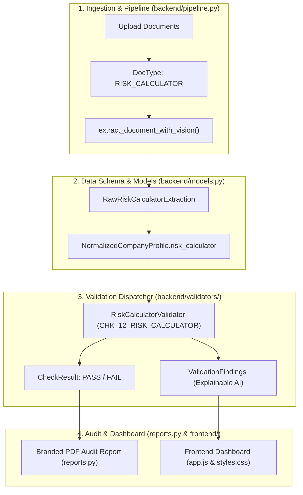

# Development Plan: Customer Risk Rating & Risk Calculator Engine

## Executive Summary & Alignment
This document establishes the architecture, specification, and implementation plan for the **Customer Risk Rating & Risk Calculator Engine** for the **GLDB Singapore Wholesale Banking Client Validator**.

The plan directly addresses the requirement:
> *"Ensure that the customer risk rating documented in the risk calculator is appropriate and consistent with the overall risk profile. Ensure that all risk calculator details (e.g., customer, beneficial owners, etc.) are completed, the risk level is accurate, and records are properly uploaded into the system."*
> **Reference Document:** Risk calculator [GLDB Internal document]

The implementation aligns seamlessly with the pre-existing system:
- **FastAPI Backend (`backend/`)**: Extension of schemas, database tables, and the vision extraction pipeline.
- **Context Aggregator & Dispatcher Pattern (`backend/validators/`)**: A dedicated validator module `backend/validators/rules/risk_calculator.py` integrated into `dispatcher.py`.
- **Explainable Findings & Audit Trail (`backend/models.py`, `backend/db.py`)**: Granular validation findings, document-level pass/fail evaluation, and PDF audit generation in `backend/reports.py`.
- **Frontend Dashboard (`frontend/app.js`, `frontend/index.html`)**: Interactive display of the individual-level and customer-level risk calculator scores, rule-based overrides, and inconsistencies.

---

## 1. Risk Features, Ingestion Sources & Cross-Validation Matrix

The Risk Calculator computes customer risk based on **10 core features**. Below is the exact mapping of:
1. **Feature Name**: What risk factor is being evaluated.
2. **Ingested Document Source(s)**: Which document(s) in the pipeline provide the ground truth data.
3. **Pipeline Ingestion & Extraction Target**: Field extracted by OCR / Vision (`extract_document_with_vision`).
4. **Cross-Validation & Risk Classification Logic**: How the system evaluates and benchmarks whether the company is **HIGH RISK**, **MEDIUM RISK**, or **LOW RISK**.

| # | Risk Calculator Feature | Ingested Document Source(s) in Pipeline | Extracted Pipeline Field(s) | Cross-Validation & Risk Band Classification Logic (High / Medium / Low) |
|---|---|---|---|---|
| **1** | **Corporate Age** | 📄 `bizfile.pdf` (ACRA BizFile) 📄 `cert_incorporation.pdf` | `incorporation_date` `bizfile_date` | • **Age Calculation**: Calculated as `today - incorporation_date`. • **HIGH RISK**: Newly established / shelf company (< 12 months) without established financial history, or dormancy period. • **MEDIUM RISK**: Operating history between 1 to 3 years. • **LOW RISK**: Established corporate history > 3 years with continuous active operations. |
| **2** | **Entity Watchlist Risk** | 📄 `screening_report.pdf` (AML Watchlist) 📄 `sanction_questionnaire.pdf` | `is_sanctioned` `watchlist_matches` `pep_connected` | • **Cross-Check**: Entity legal name & former names screened against UN, OFAC, EU, MAS sanctions lists and adverse media. • **HIGH RISK [Rule-Based Override 100]**: Direct sanctions match, law enforcement hit, or active regulatory enforcement notice. • **MEDIUM RISK**: Adverse media without sanctions, or secondary non-sanctioned regulatory inquiries. • **LOW RISK**: Clean screening with zero watchlist matches (`None` = score 0). |
| **3** | **HQ Country** | 📄 `bizfile.pdf` 📄 `cert_incorporation.pdf` 📄 `cdd_edd_questionnaire.pdf` | `place_of_incorporation` `place_of_business` `country_of_operations` | • **Cross-Check**: Cross-reference registered office country in BizFile against FATF / Basel AML Index. • **HIGH RISK [Score ≥ 75 or Rule Override 100]**: FATF Blacklist / High-Risk Jurisdictions (e.g. DPRK, Iran, Myanmar), sanctioned jurisdictions, or high-risk offshore centres. • **MEDIUM RISK [Score 50–74]**: FATF Greylist jurisdictions or developing supervisory regimes. • **LOW RISK [Score < 50]**: Singapore (Nexus), FATF member states, equivalents (e.g. OECD / Tier 1 financial centres). |
| **4** | **Operations Country** | 📄 `bizfile.pdf` (Descr. 7) 📄 `cdd_edd_questionnaire.pdf` 📄 `sanction_questionnaire.pdf` | `country_of_operations` `geographic_coverage` `routed_transaction_categories` | • **Cross-Check**: Verify operational premises, physical trade destinations, and counterparty countries from CDD form against declared business model. • **HIGH RISK**: Operations / key trading counterparties in conflict zones, FATF blacklist, EU tax havens without substance. • **MEDIUM RISK**: Cross-border emerging markets with moderate AML oversight. • **LOW RISK**: Domestic Singapore operations or low-risk APAC/global hubs. |
| **5** | **Account Type** | 📄 `board_resolution.pdf` 📄 `cdd_edd_questionnaire.pdf` | `account_purpose` `selected_product` `expected_monthly_turnover` | • **Cross-Check**: Verify requested product (e.g. Operating CASA, Loan Drawdown, Escrow, Treasury, Multi-currency trading) against company scale. • **HIGH RISK**: High-velocity cross-border pass-through accounts, trade finance in dual-use sectors, pooled client accounts without license. • **MEDIUM RISK**: Multi-currency operating accounts with cross-border trading. • **LOW RISK**: Standard Singapore domestic operating CASA for payroll, local vendor payments, and operational cash management. |
| **6** | **Industry / SSIC Code** | 📄 `bizfile.pdf` 📄 `sanction_questionnaire.pdf` (Descr. 10) | `core_business_activities` `products_services_description` `declared_traded_goods` | • **Cross-Check**: Reconcile primary/secondary ACRA SSIC code with actual traded commodities & products. • **HIGH RISK**: High-risk industries: Money Services Businesses (MSB), Virtual Asset Service Providers (VASP/Crypto), Defense/Dual-Use strategic goods, Precious stones/metals, Arms, Gambling, Extractive crude oil/bunkering. • **MEDIUM RISK**: Cross-border wholesale general merchandise, construction, shipping/freight forwarding. • **LOW RISK**: Regulated Tier-1 FIs, software/IT consulting, local retail, standard corporate services. |
| **7** | **Public Company Listing Status** | 📄 `bizfile.pdf` 📄 `cert_incorporation.pdf` 📄 `maa.pdf` | `entity_type` `company_status` | • **Cross-Check**: Check `entity_type` ('Public Listed Company' vs 'Private Limited Company' vs 'Foreign Corp'). Check exchange listing (SGX, NYSE, etc.). • **LOW RISK**: Public listed company on recognized stock exchanges (subject to strict public disclosure & regulatory transparency; simplified CDD applicable). • **MEDIUM RISK**: Established Private Limited Company with transparent corporate structure. • **HIGH RISK**: Unlisted foreign corporation, private company with bearer shares or nominee directors, or offshore shell structure. |
| **8** | **Account Opening Method / Channel** | 📄 `board_resolution.pdf` 📄 `cdd_edd_questionnaire.pdf` 📄 `id_document.pdf` | `authorizers` `has_authorizers_idv` `is_ctc` | • **Cross-Check**: Channel used for onboarding and signatory verification. • **HIGH RISK**: Fully non-face-to-face onboarding without digital identity verification (Singpass/MyInfo) or without Certified True Copy (CTC) ID attestations. • **MEDIUM RISK**: Non-face-to-face onboarding with verified CTC documents by recognized legal certifiers. • **LOW RISK**: In-person face-to-face identification by GLDB Relationship Manager or verified via Singpass MyInfo Business. |
| **9** | **Distance to Beneficial Owner (Layers)** | 📄 `ubo_declaration.pdf` 📄 `rom.pdf` (Register of Members) 📄 `ownership_structure_chart.pdf` | `ubos` `has_complex_structure` `has_nominee_arrangement` | • **Cross-Check**: Count intermediary holding layers between operating customer entity and natural person UBOs (≥25%). • **HIGH RISK [Score = 100 if unjustified]**: ≥ 3 intermediary offshore holding companies, multi-jurisdiction trusts, nominee arrangements, or circular holding structures without commercial rationale. • **MEDIUM RISK**: 1 to 2 holding company layers with documented holding structure rationale. • **LOW RISK**: Direct natural person ownership (0 or 1 single-tier domestic holding company; transparent Register of Members). |
| **10** | **Connected Party Final Score** | 📄 `risk_calculator.xlsx` / `.pdf` 📄 `ubo_declaration.pdf` 📄 `id_document.pdf` (Passports/NRIC) 📄 `proof_of_address.pdf` | `parties` (Interested parties) `citizenship` `residence_country` `watchlist_risk` | • **Cross-Check**: Aggregates all individual Interested Parties (John Tan, Jane Tan, etc.):   - Primary/Secondary Citizenship Country Score (e.g. HU=74, CA=49).   - Residence Country Score (e.g. KH=100, AE=74).   - Individual Watchlist Score (PEP / Sanctions).   - **Rule-Based Overrides**: If any party has residency/citizenship in high-risk countries (e.g., Cambodia = 100), rule-based override forces Connected Party Risk = 100. • **HIGH RISK**: Max individual score ≥ 75 or any rule-based override = 100. • **MEDIUM RISK**: Max individual score between 50 and 74. • **LOW RISK**: All interested parties scored < 50. |

---

## 2. Overall Customer Risk Rating Determination & Cross-Validation

The overall customer rating is synthesized from the **Entity-Level Features (Features 1–9)** and the **Connected Party Aggregate (Feature 10)**:

### 2.1 Risk Aggregation Engine & Formula
$$\text{Customer Model Risk Score} = \sum_{i=1}^{9} \left( w_i \times \text{Score}(\text{Feature}_i) \right) + w_{10} \times \text{Score}(\text{Connected Party Final Score})$$

Where:
- $\sum w_i = 1.0$ (calibrated GLDB weights).
- **Rule-Based Overrides (Hard Ceilings)**:
  - If **Entity Watchlist Risk == 100** $\implies$ **Final Rating = HIGH RISK (100)**
  - If **Connected Party Rule-Based Override == 100** (e.g. Cambodia residency) $\implies$ **Final Rating = HIGH RISK (100)**
  - If **Distance to BO > 2 layers without legitimate rationale** $\implies$ **Final Rating = HIGH RISK (100)**
  - If **Industry is Defense, Sanctioned Goods or Unlicensed Crypto** $\implies$ **Final Rating = HIGH RISK (100)**

$$\text{Final Customer Risk Score} = \max(\text{Customer Model Risk Score}, \text{Rule-Based Overrides})$$

### 2.2 Risk Bands
- **LOW RISK (0.0 – 49.9)**:
  - Standard Customer Due Diligence (CDD).
  - Annual throughput aligns with domestic operations, low-risk geography, direct transparent ownership.
- **MEDIUM RISK (50.0 – 74.9)**:
  - Standard Due Diligence + Wealth Accumulation Narrative (Step 18).
  - Moderate geography exposure (Greylist), established operations > 1 year.
- **HIGH RISK (75.0 – 100.0)**:
  - Mandatory **Enhanced Due Diligence (EDD)**.
  - Mandatory **Source of Wealth (SoW) Primary Corroboration** (Tax returns, audited financial statements, bank certificates).
  - Mandatory **Sanctions Questionnaire & Trade Compliance Escalation** (CHK_07).
  - Mandatory **Senior Governance Sign-Off** (RM Maker, KYC Approver, Senior Approver).

---

## 3. Documents Required for Ingestion & Verification

Summary of mandatory documents that must be uploaded to the customer bundle in the system:

| Document ID | Ingestion Doc Name in Pipeline | Source Type | Verification Role |
|---|---|---|---|
| `risk_calculator` | 📄 **Risk Calculator Sheet** (`risk_calculator.xlsx` / `.pdf`) | GLDB Internal | Target document under audit: contains recorded scores, individual inputs, rule overrides, and documented final rating. |
| `bizfile` | 📄 **ACRA BizFile / Official Registry Extract** (`bizfile.pdf`) | External Official | Ground truth for Corporate Age, HQ Country, Entity Type, SSIC Industry, Directors, Registered Address. |
| `cert_incorporation` | 📄 **Certificate of Incorporation** (`cert_incorporation.pdf`) | External Official | Legal formation date, official company name, jurisdiction of incorporation. |
| `ubo_declaration` | 📄 **GLDB Declaration of UBOs** (`ubo_declaration.pdf`) | GLDB Internal | Complete list of all natural person UBOs (≥25%), ownership percentages, declared tax residency. |
| `id_document` | 📄 **Passport / National ID / NRIC** (`id_document.pdf`) | Government ID | Verified identity, legal full name, primary/secondary citizenship for each interested party. |
| `proof_of_address` | 📄 **Proof of Residential Address** (`proof_of_address.pdf`) | Utility / Bank Bill | Verified country of physical residence (≤90 days) for each interested party. |
| `screening_report` | 📄 **AML Watchlist & Adverse Media Report** (`screening_report.pdf`) | AML Intelligence | Sanctions, PEP, and adverse news screening results for entity and interested parties. |
| `cdd_edd_questionnaire` | 📄 **CDD / EDD Questionnaire** (`cdd_edd_questionnaire.pdf`) | GLDB Internal | Account purpose, expected turnover, transaction counterparties, operations countries, Singapore nexus. |
| `board_resolution` | 📄 **Board Resolution & Mandate** (`board_resolution.pdf`) | Constitutional | Account opening method, authorized signatories, channel mandates. |
| `sow_corroboration` | 📄 **Source of Wealth Corroborating Docs** (`sow_corroboration.pdf`) | Financial Documents | Primary corroboration (audited accounts, tax notices) required if High Risk. |

---

## 4. Architecture & Codebase Integration

The implementation follows the established architecture without introducing disruptive redesigns:

### 4.1 Proposed Check Definition (`backend/rules.py`)
Add `CHK_12_RISK_CALCULATOR` to `backend/rules.py`:
- **ID**: `CHK_12_RISK_CALCULATOR`
- **Flag**: `Customer Risk Rating & Risk Calculator Integrity Review`
- **Process Step**: `Risk Rating Consistency & Calculation Accuracy (Step 27)`
- **Severity**: `High`
- **Applies To**: `["risk_calculator", "ubo_declaration", "bizfile", "id_document", "proof_of_address", "cdd_edd_questionnaire", "board_resolution"]`
- **Description**: Ensure that the customer risk rating documented in the risk calculator is appropriate and consistent with the overall risk profile across all 10 risk dimensions (Corporate Age, Entity Watchlist, HQ Country, Operations Country, Account Type, SSIC Industry, Public Listing, Onboarding Channel, Distance to BO, and Connected Parties). Ensure that all interested parties are fully evaluated, rule-based overrides are enforced, and the document is uploaded.
- **Fail When**:
  1. Risk calculator document is missing or not uploaded.
  2. Any UBO (≥25%) or director is omitted from the calculation matrix.
  3. Feature values mismatch submitted documents (e.g., residence in calculator != proof of address, citizenship != passport).
  4. Rule-based triggers are not applied (e.g., Cambodia residency omitted from rule-based override).
  5. The documented final customer risk rating is understated compared to the true risk profile.

---

## 5. Phase-by-Phase Development Plan

### Phase 1: Models & Data Persistence
- **Files**: `backend/models.py`, `backend/db.py`
- **Tasks**:
  1. Add `DocType.RISK_CALCULATOR = "risk_calculator"`.
  2. Define Pydantic models:
     - `InterestedPartyRiskItem`: `name`, `citizenship`, `citizenship_score`, `residence_country`, `residence_score`, `watchlist_risk`, `watchlist_score`, `model_risk_score`, `rule_based_risk_score`, `rule_based_reasons`, `final_risk_score`.
     - `RiskCalculatorExtraction`: `customer_name`, `corporate_age_years`, `corporate_age_score`, `entity_watchlist_score`, `hq_country`, `hq_country_score`, `operations_countries`, `operations_score`, `account_type_score`, `industry_ssic_score`, `listing_status_score`, `channel_score`, `distance_to_bo_layers`, `distance_to_bo_score`, `connected_party_aggregate_score`, `parties: List[InterestedPartyRiskItem]`, `overall_model_score`, `rule_based_overrides: List[str]`, `final_customer_risk_score`, `final_customer_risk_rating`.
  3. Update `RawDocExtraction` and `NormalizedCompanyProfile` with risk calculator fields.

### Phase 2: Vision & Extraction Pipeline
- **Files**: `backend/pipeline.py`
- **Tasks**:
  1. Add vision prompt instructions for extracting risk calculation sheets (Excel exports, PDFs, tables).
  2. Extract all 10 risk features and individual interested party rows (John Tan, Jane Tan, etc.).
  3. Parse rule-based warning boxes and notes (e.g. `[100] High risk due to: (1) Geography Risk - Country of Residence for Interested Parties`).

### Phase 3: Core Validation Rule Implementation
- **Files**: `backend/validators/rules/risk_calculator.py`, `backend/validators/rules/__init__.py`, `backend/validators/dispatcher.py`
- **Tasks**:
  1. Create `RiskCalculatorValidator`:
     - **Verification 1: Upload Check**: Verify `risk_calculator` is present in the bundle.
     - **Verification 2: Interested Party Completeness**: Ensure all UBOs (≥25%) from `ubo_declaration` and directors from `bizfile`/`rod` exist in the calculator.
     - **Verification 3: Ground-Truth Consistency**:
       - Compare `citizenship` against `id_document` passport/NRIC.
       - Compare `residence_country` against `proof_of_address` utility bills.
       - Compare `HQ Country` and `Corporate Age` against `bizfile`.
       - Compare `Operations Country` and `Account Type` against `cdd_edd_questionnaire`.
       - Compare `Distance to BO` against `ubo_declaration` and `rom`.
     - **Verification 4: Rule-Based Override Validation**: Confirm high-risk triggers (e.g., residency in Cambodia) correctly trigger the override score (100).
     - **Verification 5: Final Rating Reconciliation**: Check that documented rating (e.g., HIGH / MEDIUM / LOW) accurately matches the calculated score.
  2. Register `RiskCalculatorValidator` in `dispatcher.py`.

### Phase 4: Audit Reporting & PDF Generation
- **Files**: `backend/reports.py`
- **Tasks**:
  1. Add a dedicated **Customer Risk Profile & Risk Calculator Section** to the branded PDF audit report.
  2. Include a visual scorecard table for all 10 features, highlighting discrepancies between documented values and pipeline ground truth.

### Phase 5: Frontend UI Enhancements
- **Files**: `frontend/index.html`, `frontend/app.js`, `frontend/styles.css`
- **Tasks**:
  1. Add "Risk Calculator" badge and document category in the Upload Drawer.
  2. Add an interactive **Risk Calculation Matrix Widget** on the Bundle Details screen:
     - Showing individual scores (e.g. John Tan: 100 [High], Jane Tan: 74 [Medium]).
     - Highlighting triggered rule-based overrides with amber/red caution tags.
     - Flagging cross-document mismatches across the 10 risk dimensions.

### Phase 6: Automated Testing & Test Data Generation
- **Files**: `kyc-test-docs/generate.py`, new test script `test_risk_calculator.py`
- **Tasks**:
  1. Add sample clean and flagged risk calculator test cases (e.g., Clean match, Understated rating, Missing UBO, Country mismatch).
  2. Verify end-to-end flow from upload -> vision extraction -> deterministic validation -> PDF generation.

---

## 6. Verification & Acceptance Criteria
- [ ] Risk calculator documents are correctly classified as `risk_calculator`.
- [ ] All 10 risk features are accurately extracted and cross-validated against submitted KYC documents.
- [ ] All UBOs and Interested Parties are reconciled with 100% completeness.
- [ ] Rule-based overrides (e.g. KH-CAMBODIA = 100) are rigorously validated.
- [ ] If a rule-based override applies or high-risk triggers exist, the system prevents understating the risk rating.
- [ ] PDF Audit Report and Frontend reflect the exact details of the risk calculation.
